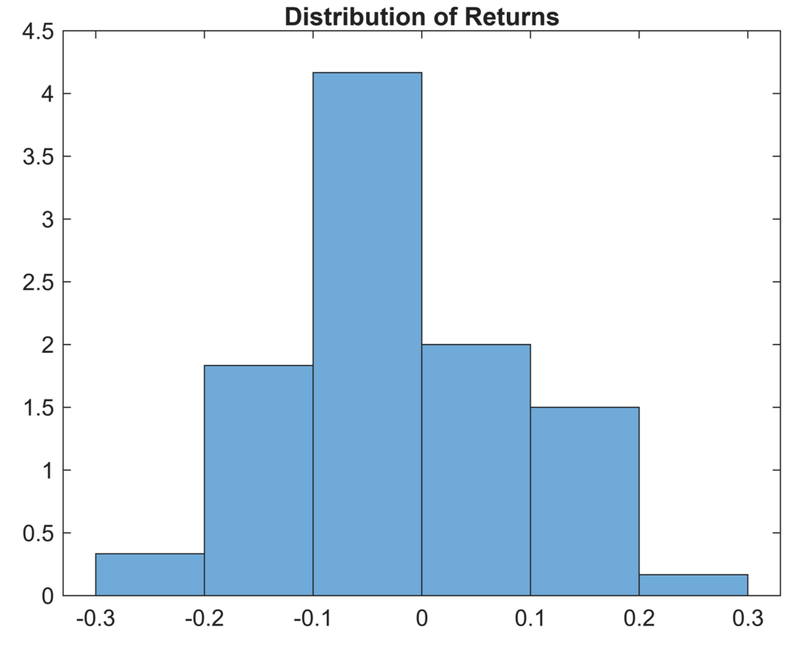
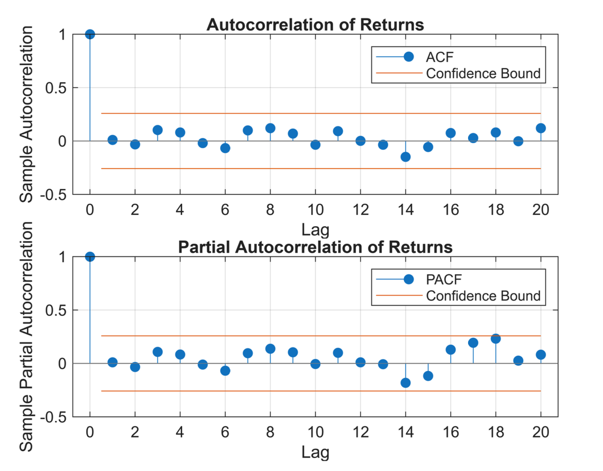

# Financial Econometrics: Modelling and Forecasting Neste Oyj Stock Returns

**MATLAB | Financial Time Series | ARMA Modelling | Box–Jenkins Methodology**

**LUT University | Financial Econometrics | 2025**

## Project Overview

This project examines the statistical properties and predictability of monthly stock returns for **Neste Oyj**, a Finnish publicly listed company operating in the energy sector.

The analysis investigates historical monthly returns from **January 2020 to December 2024**, with the objective of identifying time-series patterns, selecting an appropriate econometric model, and evaluating forecasts against observed returns in **2025**.

The research applies the **Box–Jenkins methodology**, combining exploratory data analysis, stationarity testing, autocorrelation diagnostics, model identification, parameter estimation, and forecast evaluation.

The analysis was conducted using **MATLAB**, with historical stock-price data prepared in **Microsoft Excel**.

### Research Question

*Can historical monthly stock returns of Neste Oyj be modelled and forecasted effectively using ARMA models, or does a simpler constant-mean model better describe the observed data?*

## Research Methodology

The analysis follows seven stages:

1. **Data Preparation:** Calculating monthly logarithmic returns from historical stock prices.
2. **Exploratory Data Analysis:** Examining return distributions, descriptive statistics, and normality.
3. **Stationarity Testing:** Applying Augmented Dickey–Fuller (ADF) and KPSS tests.
4. **Autocorrelation Analysis:** Examining ACF and PACF plots, supported by Ljung–Box tests.
5. **Model Identification:** Comparing ARMA specifications using Akaike Information Criterion (AIC) and Bayesian Information Criterion (BIC).
6. **Model Estimation and Diagnostics:** Estimating the selected model and evaluating residual properties.
7. **Forecast Evaluation:** Comparing model forecasts with observed monthly returns from 2025.

## Exploratory Data Analysis

### Distribution of Monthly Returns

*Figure 1. Distribution of monthly logarithmic returns for Neste Oyj.*

The descriptive analysis shows an average monthly log return of approximately **−0.0181**, with a standard deviation of **0.1024**. The return distribution is approximately symmetric, although substantial variation is observed across months.

### Autocorrelation and Partial Autocorrelation

*Figure 2. Autocorrelation and partial autocorrelation functions of monthly stock returns.*

The ACF and PACF plots indicate limited evidence of significant serial correlation. This observation is supported by the Ljung–Box test, which does not reject the null hypothesis of no autocorrelation at the tested lag setting.

## Model Selection and Key Findings

The analysis evaluates the statistical properties of the return series before selecting an appropriate ARMA specification.

| Statistical Test / Criterion | Reported Result |
|---|---|
| Augmented Dickey–Fuller test | p-value = 0.0010 |
| KPSS stationarity test | p-value = 0.1000 |
| Ljung–Box autocorrelation test | p-value = 0.9842 |
| ARCH effect test | p-value = 0.1538 |
| AIC-selected model | ARMA(2,3) |
| BIC-selected model | ARMA(0,0) |
| Estimated monthly mean return | −0.0181 |

Although the AIC selected an ARMA(2,3) specification, the BIC favoured **ARMA(0,0)**, which corresponds to a constant-mean process.

The simpler model was selected because the exploratory diagnostics provided little evidence of significant autocorrelation in monthly returns. Its estimated mean was also not statistically different from zero at conventional significance levels.

## Forecasting and Model Evaluation

The selected ARMA(0,0) model was used to generate monthly return forecasts for 2025.

Because the model contains no autoregressive or moving-average terms, the forecasts remain constant at the estimated mean return. The analysis evaluates forecast performance using Mean Absolute Error (MAE) and Mean Squared Error (MSE).

The findings highlight the limited predictability of monthly stock returns in the examined sample. They also demonstrate the importance of considering statistical diagnostics and model complexity when applying econometric forecasting techniques.

## Tools and Technologies

- **MATLAB:** Statistical analysis, econometric modelling, and forecasting.
- **Microsoft Excel:** Historical price data preparation and return calculations.
- **ARMA/ARIMA Modelling:** Financial time-series analysis.
- **Statistical Testing:** ADF, KPSS, Jarque–Bera, Ljung–Box, and ARCH tests.
- **Model Selection:** AIC and BIC.

## Project Report

**[View the complete financial econometrics analysis](Neste_data_analysis_and_modelling.pdf)**

The report contains the original MATLAB code excerpts, statistical test results, visualisations, model estimation, residual diagnostics, and forecasting evaluation.

This repository documents the original empirical study rather than providing a standalone executable MATLAB application.

## Limitations

The analysis uses a relatively small sample of monthly observations, which can limit the ability to detect weak time-series relationships.

The absence of statistically significant autocorrelation does not establish that stock returns are universally unpredictable. Rather, it suggests that the observed data provide limited evidence of predictable conditional-mean dynamics under the specifications examined.

The forecasting results are presented as originally reported in the analysis. The alignment of monthly return observations in the source workbook should be verified before relying on the forecast-error metrics for independent replication.

Potential extensions include investigating higher-frequency returns and examining volatility dynamics using GARCH-type models.

---

*Academic financial econometrics project developed at LUT University. For educational and research purposes only; not investment advice.*
